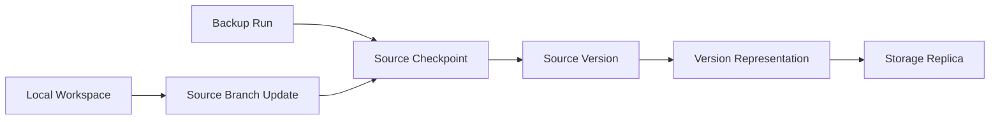

# 配置与不可变历史模型

## 用户配置

`AppConfig` 组织全局设置、项目和预设。`BackupConfig` 保存稳定 ID、修订、Kind、来源、归档、过滤、自动化、云与加密设置。`ManagedFolder` 保留来源 ID、路径、显示名、SourceScope 和 Provider State。

Kind 使用 OwnerId + KindId，提供器状态使用 StateOwnerId + 项目及可选来源定位。配置显示名称可以变化，身份继续用于历史关联。

## 共享历史事实

Backup Run 记录一次调用及参与来源的结果。Source Checkpoint 记录单个来源的历史位置和 Version；Checkpoint parents 表达历史延续，Version parents 表达内容来源。

每个来源拥有自己的 Branch，同一项目的两个来源可以分别使用 `main`。Branch Update 通过不可变更新推进分支。普通还原更新内容基线，Checkout 切换活动分支。

Representation 说明版本的物化方式、依赖与精度，Replica 记录物理副本生命周期。Commit Pack 原子公开共享事实，Annotation 记录备注、Pin 和展示更新。

## 本机状态与缓存

Workspace 持久记录活动分支、延续锚点和内容基线，Local Replica Catalog 记录本机载荷位置；两者由本机管理。History Index 和 Capture Baseline Cache 可从已有事实或新捕获重建。

Safety Snapshot 独立保护来源检查点及依赖，保持活动分支状态。配置、历史和归档通过各自的[迁移流程](/docs/guides/data-migration)搬迁。

公开插件快照使用 Abstractions record，Host 内部模型由应用与 Core 管理。

