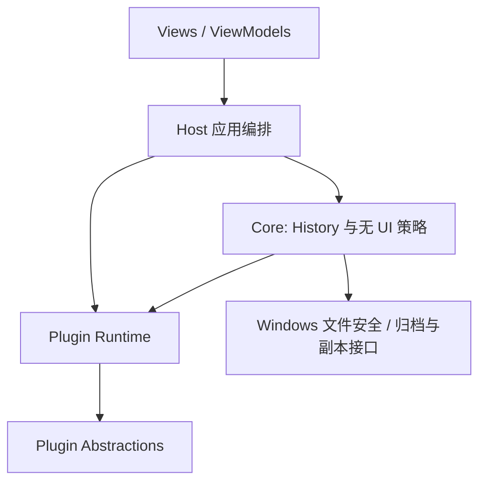

# 架构总览

> 本页描述 1.10 开发分支的重构布局，尚未表示正式版已发布。

FolderRewind 使用 .NET 10 与 WinUI 3。准确 SDK 与包版本由源码中的 global.json、项目文件及集中包版本配置声明。

Host 负责配置持久化、操作调度、通知与平台适配。Core 通过显式输入、服务实例和取消令牌执行核心操作，返回结果与诊断；不会反向查找应用全局服务。插件仍负责领域语义，不能绕过 Host 的事务、完整性检查与目标目录修改。

正式 Core 与普通测试共享编译边界。故障恢复验收使用同一项目的隔离构建，正式产物不包含测试故障入口。Core 是内部实现库，不作为新的公开插件 SDK 发布。

参阅[目录](/docs/architecture/directory-structure)、[模式](/docs/architecture/patterns)、[服务](/docs/architecture/services)、[模型](/docs/architecture/data-models)和[插件边界](/docs/architecture/plugin-system)。

