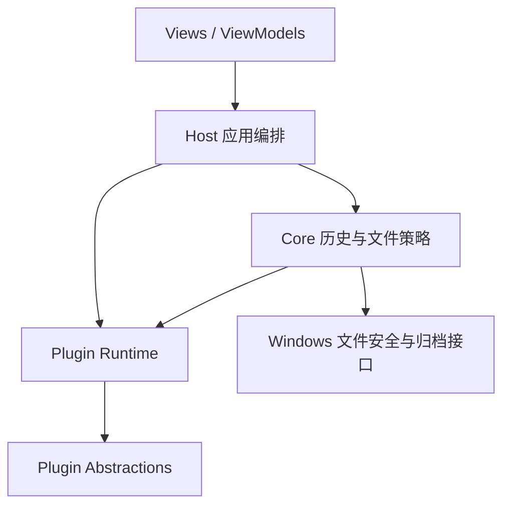

# 架构总览

FolderRewind 使用 .NET 10 与 WinUI 3。项目文件、`global.json` 和集中包版本配置声明实际构建依赖。

Host 负责配置、调度、通知、平台与生命周期适配。Core 接收显式输入与依赖，执行捕获、历史、恢复、合并、保留和副本算法，返回结果与诊断。

插件通过独立的 Abstractions 契约提供领域能力。Runtime 管理安装、激活、能力路由、调用租约和受控 Artifact 服务。目标写入、事务、完整性、加密与云操作由 Host 组织。

Core 面向 Windows 并独立于 WinUI。普通测试引用正式 Core，故障恢复测试使用隔离输出和显式故障注入配置。插件开发入口为公开 Abstractions 包。

继续阅读[目录结构](/docs/architecture/directory-structure)、[模式](/docs/architecture/patterns)、[服务](/docs/architecture/services)、[数据模型](/docs/architecture/data-models)和[插件架构](/docs/architecture/plugin-system)。

