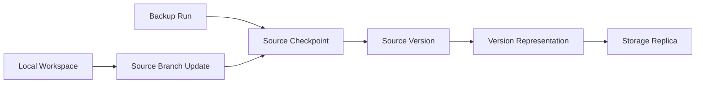

# Configuration and immutable history models

## User configuration

`AppConfig` organizes global settings, projects and presets. `BackupConfig` stores stable identity, revision, Kind, sources, archive, filters, automation, cloud and encryption settings. `ManagedFolder` retains source ID, path, display name, SourceScope and Provider State.

A Kind is OwnerId + KindId. Provider state is addressed by StateOwnerId, project and optional source. Display names can change while identities continue linking history.

## Shared history facts

A Backup Run records an invocation and its participating source outcomes. A Source Checkpoint represents one source's history position and Version. Checkpoint parents express history continuation; Version parents express content ancestry.

Each source owns its Branches, so two sources in one project can each use `main`. Immutable Branch Updates advance branches. Ordinary restore updates the content baseline; Checkout changes the active branch.

A Representation describes materialization, dependencies and fidelity. A Replica records a physical copy's lifecycle. Commit Packs atomically publish shared facts, and Annotations update comments, Pins and presentation.

## Local state and caches

Workspace durably tracks active branches, continuation anchors and content baselines. Local Replica Catalog tracks local payload locations. Both are managed per device. History Index and Capture Baseline Cache can be rebuilt from facts or new capture.

Safety Snapshots protect source checkpoints and dependencies independently of active branches. Move configuration, history and archives through their respective [migration workflows](/docs/guides/data-migration).

Public plugin snapshots use Abstractions records. The app and Core manage internal Host models.

