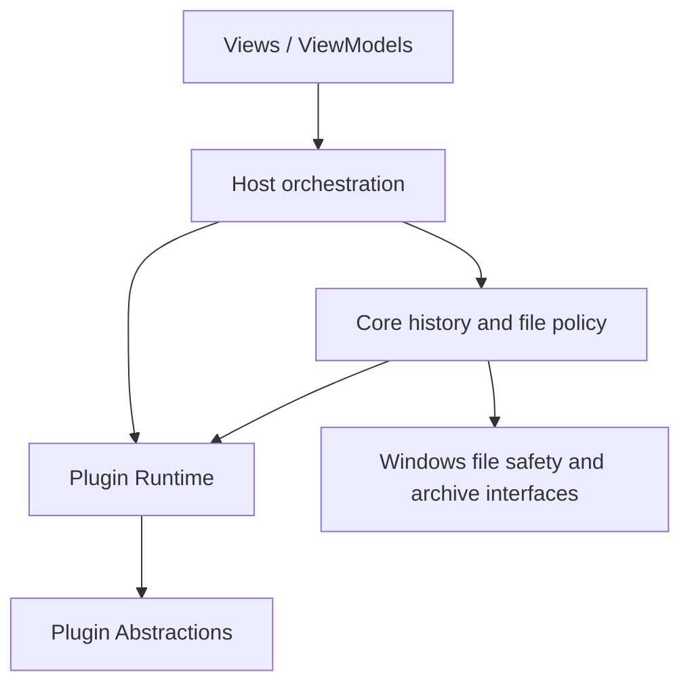

# Architecture overview

FolderRewind uses .NET 10 and WinUI 3. Project files, `global.json` and central package configuration declare the actual build dependencies.

The Host handles configuration, scheduling, notifications, platform and lifecycle adaptation. Core accepts explicit inputs and dependencies, performs capture, history, recovery, merging, retention and replica algorithms, and returns results and diagnostics.

Plugins provide domain capabilities through independent Abstractions contracts. Runtime manages installation, activation, routing, invocation leases and scoped Artifact services. The Host orchestrates destination writes, transactions, integrity, encryption and cloud operations.

Core targets Windows independently of WinUI. Ordinary tests reference production Core; recovery tests use isolated output and an explicit fault-injection configuration. Public Abstractions is the plugin development entry point.

Continue with [directories](/docs/architecture/directory-structure), [patterns](/docs/architecture/patterns), [services](/docs/architecture/services), [data models](/docs/architecture/data-models) and [plugin architecture](/docs/architecture/plugin-system).

