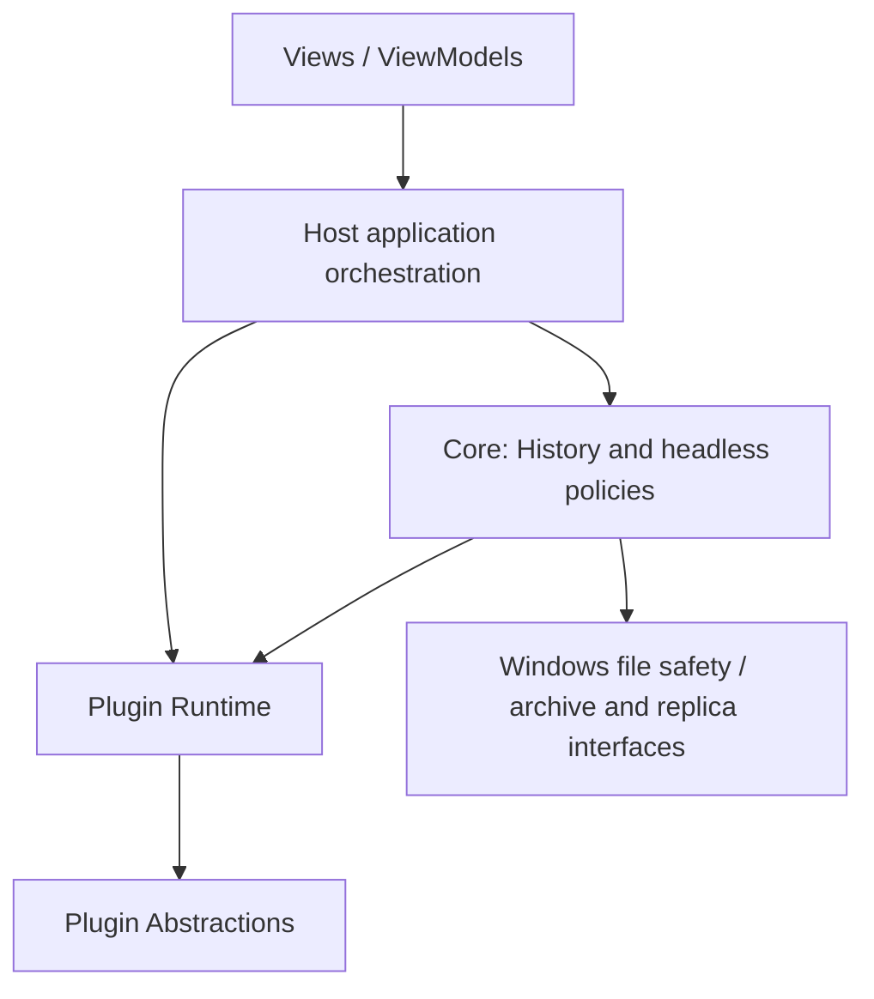

# Architecture overview

> This page describes the 1.10 development layout; it does not announce a released version.

FolderRewind uses .NET 10 and WinUI 3. The exact SDK and package versions are declared by global.json, project files and central package version configuration in the source checkout.

The Host owns configuration persistence, scheduling, notifications and platform adapters. Core receives explicit inputs, service instances and cancellation tokens and returns results and diagnostics; it does not resolve application globals. Plugins own domain semantics and cannot bypass Host transactions, integrity checks or target-directory mutation.

Production Core and ordinary tests share a compilation boundary. Recovery acceptance uses an isolated build of the same project; shipping artifacts exclude test fault hooks. Core is an internal library, not another public plugin SDK.

See [directories](/docs/architecture/directory-structure), [patterns](/docs/architecture/patterns), [services](/docs/architecture/services), [models](/docs/architecture/data-models) and [plugin boundaries](/docs/architecture/plugin-system).

